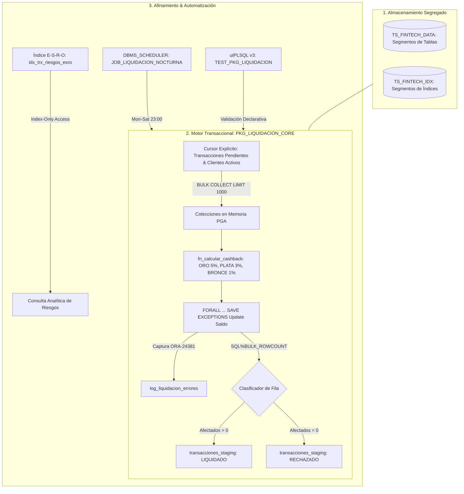

# 💳 Core Settlement & Cashback Engine (Oracle 23ai)

[](#)
[](#)
[](#)
[](#)
[](LICENSE)

Backend transaccional de conciliación, liquidación masiva y acreditación de cashback para pasarelas de pago y billeteras digitales fintech. Diseñado para mitigar la contención física de E/S mediante segregación de tablespaces, procesamiento batch resiliente en memoria (PGA), optimización CBO bajo la regla E-S-R-O (*Index-Only Access*), automatización con `DBMS_SCHEDULER` y aseguramiento continuo con `utPLSQL v3`.

---

## 🏗️ Arquitectura del Sistema



---

## 🎯 Pilares Técnicos Implementados

### 1. Segregación Física en Tablespaces
* **`TS_FINTECH_DATA`:** Contiene los datos transaccionales (`clientes_billetera`, `transacciones_staging`, `log_liquidacion_errores`).
* **`TS_FINTECH_IDX`:** Aloja los índices de clave primaria y secundarios, reduciendo la contención de lectura y escritura en los bloques de datos.

### 2. Procesamiento Masivo en Memoria y Manejo de Errores
* **Batching con límite controlado:** Extracción mediante `CURSOR` explícito con `BULK COLLECT INTO ... LIMIT 1000` para restringir la huella de memoria PGA.
* **Resiliencia en actualización:** Uso de `FORALL ... SAVE EXCEPTIONS` para evitar la interrupción del lote ante registros inconsistentes.
* **Auditoría de excepciones:** Captura de `ORA-24381` con iteración sobre `SQL%BULK_EXCEPTIONS` registrando el `trx_id`, código y mensaje de error en `log_liquidacion_errores`.
* **Clasificación determinista:** Uso de `SQL%BULK_ROWCOUNT` para segregar en una sola pasada las operaciones procesadas (`LIQUIDADO`) de las rechazadas (`RECHAZADO`).

### 3. Tuning Analítico: Regla E-S-R-O e Index-Only Access
Para optimizar la consulta analítica recurrente de auditoría de riesgos:

```sql
SELECT categoria,
       COUNT(*) AS total_operaciones,
       SUM(monto_compra) AS volumen_total
  FROM transacciones_staging
 WHERE estado_proc = 'LIQUIDADO'
   AND fecha_trx >= TO_DATE('2026-10-01', 'YYYY-MM-DD')
   AND fecha_trx < TO_DATE('2026-11-01', 'YYYY-MM-DD')
 GROUP BY categoria;
```

Se diseñó el índice compuesto `idx_trx_riesgos_esro` en `TS_FINTECH_IDX` aplicando la regla E-S-R-O:
* **E (Equality):** `estado_proc` (`= 'LIQUIDADO'`)
* **S (Sort/Group):** `categoria` (`GROUP BY categoria`)
* **R (Range):** `fecha_trx` (`>= :ini AND < :fin`)
* **O (Other / Proyección):** `monto_compra` (permite calcular `SUM` sin acceder a la tabla)

#### Plan de Ejecución Real Obtenido (`DBMS_XPLAN - ALLSTATS LAST`)
El optimizador basado en costos (CBO) ejecuta un `INDEX RANGE SCAN` directo sin visitas a la tabla (`TABLE ACCESS BY INDEX ROWID: 0`) y aprovecha el orden físico del índice para eliminar la necesidad de ordenamiento intermedio (`SORT GROUP BY NOSORT`):

```text
-------------------------------------------------------------------------------------------------------
| Id  | Operation            | Name                 | Starts | E-Rows | A-Rows |   A-Time   | Buffers |
-------------------------------------------------------------------------------------------------------
|   0 | SELECT STATEMENT     |                      |      1 |        |      1 |00:00:00.01 |      67 |
|   1 |  SORT GROUP BY NOSORT|                      |      1 |      1 |      1 |00:00:00.01 |      67 |
|*  2 |   INDEX RANGE SCAN   | IDX_TRX_RIESGOS_ESRO |      1 |      1 |      1 |00:00:00.01 |      67 |
-------------------------------------------------------------------------------------------------------

Predicate Information (identified by operation id):
---------------------------------------------------
   2 - access("ESTADO_PROC"='LIQUIDADO' AND "FECHA_TRX">=TO_DATE(' 2026-10-01 00:00:00',
              'syyyy-mm-dd hh24:mi:ss') AND "FECHA_TRX"<TO_DATE(' 2026-11-01 00:00:00',
              'syyyy-mm-dd hh24:mi:ss'))
```

### 4. Automatización con DBMS_SCHEDULER
* Script idempotente con eliminación defensiva previa (`DBMS_SCHEDULER.DROP_JOB(..., force => TRUE)`).
* Programación nocturna con `REPEAT_INTERVAL` de lunes a sábado a las 23:00 horas (`FREQ=WEEKLY; BYDAY=MON,TUE,WED,THU,FRI,SAT; BYHOUR=23; BYMINUTE=0; BYSECOND=0`).

### 5. Aseguramiento de Calidad con utPLSQL v3
Suite de pruebas unitarias declarativas (`TEST_PKG_LIQUIDACION`) con cobertura de reglas de negocio y ciclo de vida de limpieza:

```text
Suite de pruebas liquidación y cashback
Verificar que cliente ORO con compra de 100,000 recibe 5,000 de cashback [.195 sec]
Verificar que cliente BRONCE con compra de 50,000 recibe 500 de cashback [.013 sec]
Procesamiento de lote diario liquida transacciones pendientes y actualiza saldo [.294 sec]

Finished in .532208 seconds
3 tests, 0 failed, 0 errored, 0 disabled, 0 warning(s)
```

---

## 📂 Estructura del Repositorio

```text
fintech-settlement-engine/
├── docker/
│   ├── docker-compose.yml              # Despliegue reproducible de Oracle 23ai Free
│   └── init/
│       └── 01_setup_tablespaces.sql    # DDL de tablespaces y esquemas
├── src/
│   ├── ddl/
│   │   ├── 01_tables_and_constraints.sql # Modelo relacional normalizado
│   │   ├── 02_tuning_esro_index.sql     # Índice compuesto determinista
│   │   └── 03_benchmark_telemetry.sql   # Generación de carga y telemetría CBO
│   ├── packages/
│   │   ├── pkg_liquidacion_core.pks     # Especificación del paquete transaccional
│   │   └── pkg_liquidacion_core.pkb     # Lógica batch, FORALL y ref cursors
│   ├── jobs/
│   │   └── scheduler_settlement_job.sql # Automatización nocturna DBMS_SCHEDULER
│   └── tests/
│       ├── test_pkg_liquidacion.pks     # Especificación suite utPLSQL v3
│       └── test_pkg_liquidacion.pkb     # Aserciones y control de rollback
├── docs/
│   └── telemetry/
│       ├── execution_plan_esro.txt      # Traza real de ejecución CBO
│       └── utplsql_results.txt          # Reporte de pruebas unitarias
└── README.md
```

---

## 🛠️ Guía de Ejecución Local

### 1. Desplegar la Base de Datos
```bash
docker compose -f docker/docker-compose.yml up -d
```

### 2. Compilar Objetos del Esquema
```bash
# Tablas e Índices
docker exec -i oracle-23ai-fintech sqlplus -S 'FINTECH_USER/FintechMaster2026!@localhost:1521/FREEPDB1' < src/ddl/01_tables_and_constraints.sql
docker exec -i oracle-23ai-fintech sqlplus -S 'FINTECH_USER/FintechMaster2026!@localhost:1521/FREEPDB1' < src/ddl/02_tuning_esro_index.sql

# Paquete Core
docker exec -i oracle-23ai-fintech sqlplus -S 'FINTECH_USER/FintechMaster2026!@localhost:1521/FREEPDB1' < src/packages/pkg_liquidacion_core.pks
docker exec -i oracle-23ai-fintech sqlplus -S 'FINTECH_USER/FintechMaster2026!@localhost:1521/FREEPDB1' < src/packages/pkg_liquidacion_core.pkb

# Programación de Tareas
docker exec -i oracle-23ai-fintech sqlplus -S 'FINTECH_USER/FintechMaster2026!@localhost:1521/FREEPDB1' < src/jobs/scheduler_settlement_job.sql
```

### 3. Ejecutar las Pruebas Unitarias
```bash
docker exec -i oracle-23ai-fintech sqlplus -S 'FINTECH_USER/FintechMaster2026!@localhost:1521/FREEPDB1' << 'EOF'
SET SERVEROUTPUT ON SIZE UNLIMITED;
EXEC ut.run('test_pkg_liquidacion');
EXIT;
EOF
```

### 4. Consultar Auditoría del Job Nocturno
```sql
SELECT log_id,
       job_name,
       status,
       actual_start_date,
       run_duration
  FROM user_scheduler_job_run_details
 WHERE job_name = 'JOB_LIQUIDACION_NOCTURNA'
 ORDER BY actual_start_date DESC;
```

---

## 👤 Autor

**Juan Camilo Marín García**  
*SQL Data Engineer & Database Architecture Specialist*